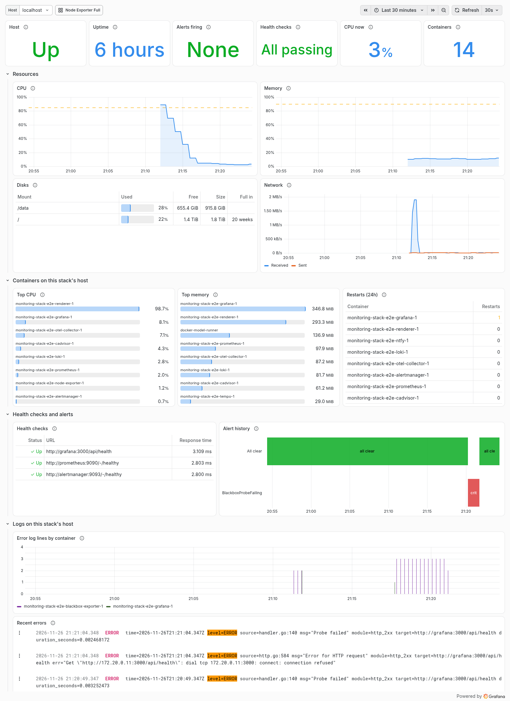
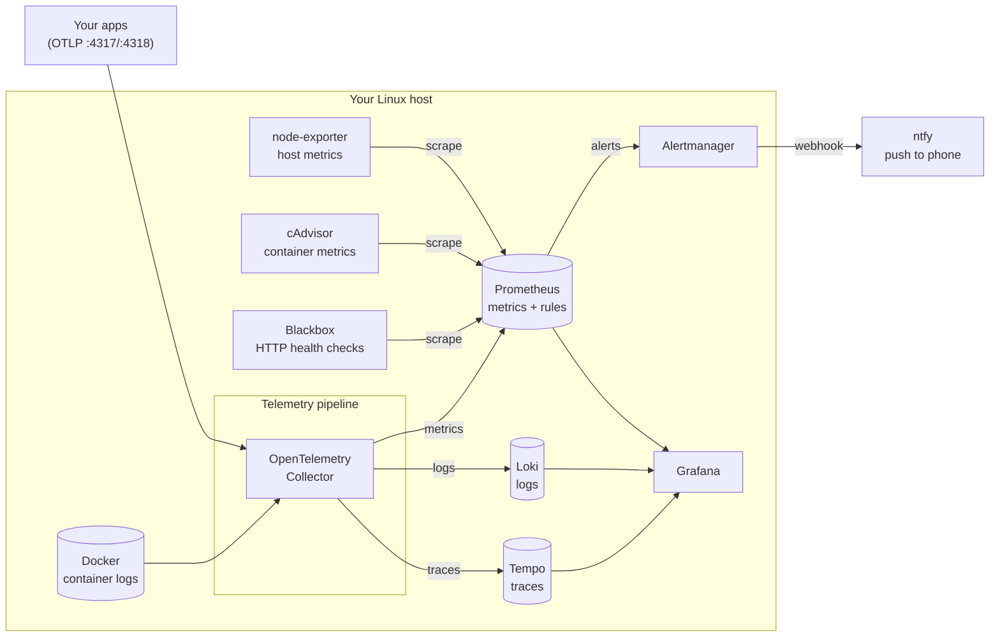

# monitoring-stack

[](https://github.com/dj-3dub/monitoring-stack/actions/workflows/ci.yml)

Metrics, logs, traces and phone alerts for the machine it runs on, in one
`make up`. Built for homelabs: clone it, run two commands, and get a push
notification when a disk is filling up or a service stops answering.

- **Metrics**: host CPU, memory, disk and network (node-exporter) and
  per-container usage (cAdvisor), stored in Prometheus
- **Logs**: every container's logs on the host collected automatically by the
  OpenTelemetry Collector and searchable in Loki
- **Traces**: send OpenTelemetry from your own apps; traces land in Tempo,
  linked to their logs
- **Alerts**: to your phone through [ntfy](https://ntfy.sh), with no account and
  no app-specific setup
- **Dashboards**: a custom Host overview home page in Grafana, with every data
  source and dashboard provisioned as code
- **Deploy anywhere**: run locally, or let Terraform install it on another
  Linux box over SSH (Terraform itself can run in a container)

<picture>
  <source media="(prefers-color-scheme: dark)" srcset="docs/images/host-overview-dark.png">
  
</picture>

## Quick start

Needs Docker with Compose v2 on Linux.

```bash
git clone https://github.com/dj-3dub/monitoring-stack.git
cd monitoring-stack
make setup        # creates .env with a generated password and private ntfy topic
make up
make test-alert   # sends a notification to check alerts reach you
```

`make setup` prints the ntfy topic to subscribe to (in the
[ntfy app](https://ntfy.sh/#subscribe-phone) or a browser) and where to find
Grafana: `http://<this-machine>:3000`.

Run `make` to see every command.

## Architecture



| Component | Role |
| --- | --- |
| **Prometheus** | Scrapes metrics, evaluates alert rules, and accepts OTLP metrics |
| **node-exporter** | Host metrics. Runs on the host network so it sees real interfaces |
| **cAdvisor** | Per-container CPU, memory and network |
| **Blackbox Exporter** | HTTP health checks for any URL you list |
| **OpenTelemetry Collector** | One pipeline for all telemetry: discovers containers through the Docker API, reads their logs, and routes OTLP from apps |
| **Loki** | Log storage, labelled by container |
| **Tempo** | Trace storage |
| **Alertmanager** | Groups, deduplicates and routes alerts to ntfy |
| **Grafana** | Dashboards and Explore, with traces linked to logs |

## Alerts

| Alert | Fires when | Severity |
| --- | --- | --- |
| `HostDown` | A monitored host's node-exporter is unreachable for 2 minutes | critical |
| `BlackboxProbeFailing` | An HTTP health check fails for 2 minutes | critical |
| `DiskAlmostFull` | A filesystem is over 95% for 5 minutes | critical |
| `DiskWillFillIn24h` | A filesystem's trend over 6 hours says it fills within a day | warning |
| `DiskFillingUp` | A filesystem is over 85% for 10 minutes | warning |
| `HighCPU` | CPU is over 85% for 10 minutes | warning |
| `HighMemory` | Memory is over 90% for 10 minutes | warning |
| `MonitoringComponentDown` | Part of this stack stops responding | warning |

- Critical alerts arrive as **urgent** ntfy notifications and warnings at normal
  priority. You also get a "resolved" message when the problem clears.
- Every alert carries `host=<HOST_NAME>`, so alerts from several friends' or
  machines' stacks stay distinguishable.
- While a critical alert is firing for an instance, its warnings are held back.

Rules are in [`config/prometheus/rules/`](config/prometheus/rules/) and have
unit tests in [`tests/rules/`](tests/rules/alerts.test.yml).

## The Host overview dashboard

Grafana opens on **Host overview**, a dashboard built for this stack. Top to
bottom:

| Section | What it answers |
| --- | --- |
| **Status** | Is the host up, is anything alerting, are health checks passing? |
| **Resources** | CPU and memory over time, with alert thresholds drawn as dashed lines. Each disk's use, free space, and how long until it fills at the current rate |
| **Containers** | Which containers use the most CPU and memory, and which keep restarting (crash loops) |
| **Health checks and alerts** | Every HTTP check with its response time, and a timeline of which alerts fired when |
| **Logs** | Error log volume per container, and the latest error lines |

The **Host** picker at the top switches between this machine and any host in
`nodes.yml`. The container and log sections always show the machine the stack
runs on. **Node Exporter Full** (linked at the top) has every host metric in
detail.

The dashboard follows a few rules:

- **Status colours are only used for state.** Green, yellow and red always
  come with a text label ("Up", "All passing", "critical").
- **Single measures use one hue.** Disk usage reads as a meter list, not a row
  of gauges.
- **Container colours follow the container's name,** so they don't reshuffle
  when containers start or stop.
- **The error-log filter matches log levels** (`level=error`, `"level":"error"`,
  `ERROR:`), not every line that mentions the word "error".

## Logs and traces

Container logs are collected automatically. In Grafana, open **Explore →
Loki** and try:

```logql
{container_name="monitoring-stack-grafana-1"}
{container_name=~".+"} |= "error"
```

To send traces, metrics or logs from your own applications, point any
OpenTelemetry SDK at this machine:

```bash
OTEL_EXPORTER_OTLP_ENDPOINT=http://<this-machine>:4318
OTEL_SERVICE_NAME=my-app
```

Traces show up in **Explore → Tempo**. From a span you can jump to that
service's logs, and log lines that carry a `trace_id` link back to the trace.

## Monitoring more machines

Install node-exporter on each machine (on Debian/Ubuntu:
`sudo apt install prometheus-node-exporter`), then:

```bash
cp config/prometheus/targets/nodes.yml.example config/prometheus/targets/nodes.yml
# list the machines in nodes.yml
```

Prometheus picks up changes to this file within a minute, without a restart.
To health-check a website or service, add its URL under the `blackbox_http`
job in [`config/prometheus/prometheus.yml`](config/prometheus/prometheus.yml).

## Deploying to another machine with Terraform

Terraform can install the stack on any Linux host you can SSH into, and can
install Docker there first if needed.

```bash
cp terraform/terraform.tfvars.example terraform/terraform.tfvars   # set host and ssh_user
make tf-init
make tf-apply
make tf-output    # Grafana URL, password and ntfy topic
```

If Terraform isn't installed, the `make tf-*` commands run the official
Terraform container instead. See [`terraform/README.md`](terraform/README.md)
for the details.

## Configuration

All settings are in `.env` (created by `make setup`; documented in
[`.env.example`](.env.example)). The ones you're most likely to change:

| Variable | Default | Meaning |
| --- | --- | --- |
| `HOST_NAME` | machine's hostname | Name shown in alerts |
| `NTFY_URL` / `NTFY_TOPIC` | ntfy.sh / generated | Where alerts go; use your own ntfy server if you have one |
| `BIND_ADDRESS` | `0.0.0.0` | Where Grafana and OTLP listen |
| `ADMIN_BIND_ADDRESS` | `127.0.0.1` | Where Prometheus and Alertmanager listen (they have no login) |
| `PROMETHEUS_RETENTION_TIME` / `_SIZE` | `15d` / `10GB` | How much metric history to keep |

## Backup and restore

```bash
make backup                                   # writes backups/monitoring-stack-<host>-<date>.tar.gz
make restore FILE=backups/<file>.tar.gz
```

A backup contains `.env`, your target list and every data volume: Grafana
users and dashboards, metrics, logs, traces and Alertmanager silences. Services
pause for a few seconds so the copy is consistent. The archive contains your
secrets, so it is created readable only by you.

## How it's tested

Every push runs [CI](.github/workflows/ci.yml):

1. **Lint**: every config is validated by the real tool at the version the
   stack runs (`promtool`, `amtool`, `otelcol validate`, `loki -verify-config`,
   `docker compose config`, `terraform validate`/`fmt`), plus shellcheck.
2. **Alert rule unit tests**: `promtool test rules` feeds synthetic metrics
   through each rule and checks exactly which alerts fire, with which labels
   and text.
3. **End to end** ([`tests/e2e.sh`](tests/e2e.sh)): starts the real stack
   next to a local ntfy server, then checks:
   - every scrape target is up
   - container logs reach Loki
   - an OTLP trace, metric and log land in Tempo, Prometheus and Loki
   - stopping Grafana produces an urgent alert on ntfy, and restarting it
     produces the "resolved" message
   - every Host overview panel query runs, and returns data where it should
   - a backup restores into an empty stack

   Each run also renders the dashboard in light and dark themes and uploads
   the screenshots as a build artifact.
4. **Terraform** ([`tests/terraform/run.sh`](tests/terraform/run.sh)):
   - deploys with the Terraform container to a throwaway SSH + Docker host
   - checks the services and the generated Grafana password
   - checks that a second `plan` is empty
   - checks that `destroy` stops the stack but keeps the data

Run the same checks locally with `make test`, `make test-e2e` and
`make test-terraform`. They need only Docker.

## Design decisions

- **Compose is the single definition of the stack.** Terraform copies the files
  and runs `docker compose up` rather than redefining every container with
  Terraform's Docker provider. Two definitions of the same stack drift apart.
  The trade-off is that Terraform uses provisioners, which HashiCorp calls a
  last resort. Here the "infrastructure" is a host you already own, so there is
  no cloud API to manage instead.
- **The OpenTelemetry Collector is the only telemetry agent.** Logs, traces and
  app metrics all go through one vendor-neutral pipeline, instead of one agent
  per signal (such as Promtail, which is now end-of-life). Any backend can be
  swapped by changing an exporter.
- **ntfy over email, Slack or Discord.** It needs no account, SMTP settings or
  webhook setup, so a friend's alerts work within a minute of `make setup`. Its
  built-in Alertmanager template formats the messages. Topics on ntfy.sh are
  public, so setup generates a long random topic name.
- **Secure by default, without getting in the way.** Prometheus and Alertmanager
  have no authentication, so they listen on localhost only. Grafana gets a
  generated password, and `.env` is created with mode 600.
- **Named volumes, not bind mounts.** Each image initialises its own volume with
  the right ownership. This removed a whole class of "permission denied on
  first start" bugs that bind-mounted data folders caused.
- **Versions are pinned.** Upgrading means changing a version in `compose.yaml`,
  and CI runs the full end-to-end test on that change, so `make update` never
  pulls a surprise major version.

## Limitations

- **If the host itself goes down, nothing alerts**, because the stack goes down
  with it. To catch that, run a second copy elsewhere and list this host in its
  `nodes.yml`.
- Host system logs (journald) aren't collected yet, only container logs.
- Linux only. cAdvisor and node-exporter need a Linux Docker host, and Docker
  Desktop's VM hides the real host.

## Security notes

- **Docker socket:** the OTel Collector mounts it read-only to discover
  containers. Read-only stops file writes, not API calls, so treat the
  Collector as trusted.
- **Collector runs as root:** it needs this to read Docker's log files.
- **Privileged cAdvisor:** cAdvisor runs privileged, as its upstream
  instructions require.
- **node-exporter is reachable from your LAN:** it listens on port 9100 on all
  interfaces, which is normal for node-exporter. Firewall it if your network
  isn't trusted.

## License

[MIT](LICENSE)
